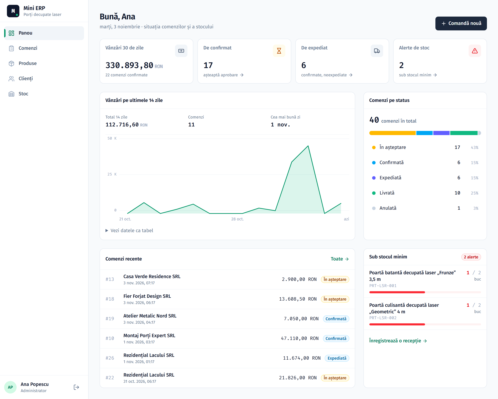
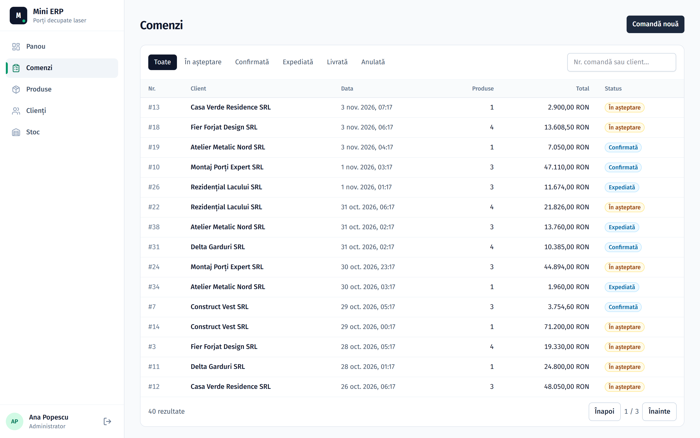
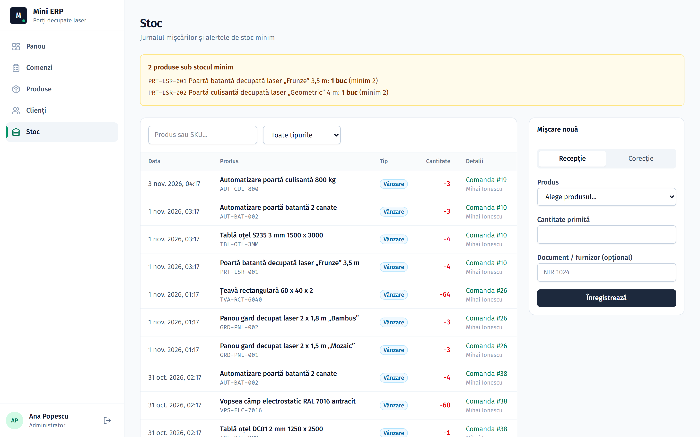
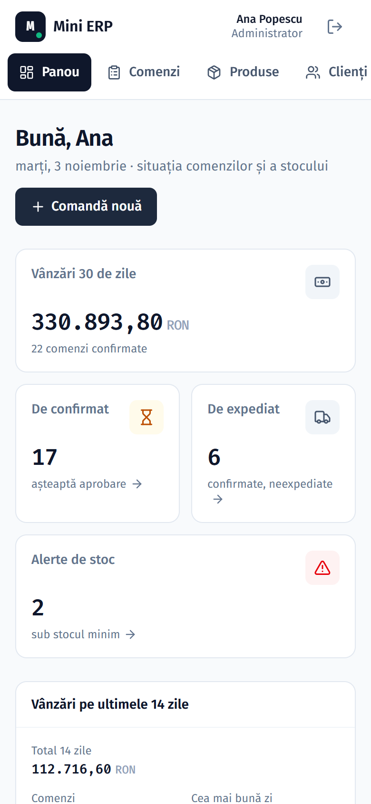

# Mini ERP: orders, stock, customers

Internal app for a workshop that manufactures laser-cut gates and fences: product catalog, customers, orders with an approval workflow, stock with a movement ledger, and automatic low-stock alerts.

The UI is in Romanian, since the target users are a Romanian business.



**Stack:** Node.js · Express 5 · Prisma 7 · PostgreSQL · Next.js 16 · React 19 · TanStack Query · Tailwind 4 · BullMQ + Redis · Zod · Vitest + Supertest · Docker · GitHub Actions

```
apps/
  api/   Express + Prisma (REST, authentication, roles, background jobs)
  web/   Next.js (UI)
```

## Screenshots

| Orders | Stock ledger |
|---|---|
|  |  |

<p>
  
</p>

Design direction (flat style, slate + emerald palette, Fira Sans / Fira Code) generated with the [ui-ux-pro-max](https://github.com/nextlevelbuilder/ui-ux-pro-max-skill) design-system skill.

## Quick start

### Everything in Docker

```bash
docker compose up -d --build
docker compose exec api node dist/seed.js   # demo data
```

App: http://localhost:3000 · API: http://localhost:4000/api/health

This starts 5 containers: Postgres 17, Redis 7, the API (applies migrations on startup), the BullMQ worker and the Next.js UI.

### Local development

Postgres and Redis run in Docker, the code runs locally with hot reload:

```bash
npm install
cp apps/api/.env.example apps/api/.env
npm run dev:db                                  # Postgres + Redis in Docker
cd apps/api && npx prisma migrate deploy && npm run db:seed && cd ../..
npm run dev:api                                 # terminal 2
npm run dev:worker                              # terminal 3
npm run dev:web                                 # terminal 4
```

Without `REDIS_URL` in `apps/api/.env`, background jobs run inline in the API process and the worker isn't needed.

### Demo accounts (password `Demo1234!`)

| Email | Role | Can do |
|---|---|---|
| admin@demo.ro | Admin | everything |
| vanzari@demo.ro | Sales | customers, create / confirm / cancel orders |
| depozit@demo.ro | Warehouse | stock receipts and adjustments, ship / deliver orders |

## Tests

```bash
npm test
```

Integration tests run against a real Postgres, in a separate database (`mini_erp_test`, see `apps/api/.env.test`), so they need `npm run dev:db` running. They cover authentication, per-role permissions, server-side order totals, transactions, the status workflow, stock alerts and **two simultaneous confirmations competing for the last units in stock**.

## Architecture decisions

**Module-based layout** (`modules/orders`, `modules/stock` etc.), each with `routes` (HTTP), `schemas` (Zod validation) and `service` (business logic + Prisma). Routes stay thin; logic is tested through the API, without database mocks.

**Permissions, not roles, in routes.** `auth/permissions.ts` is the single source of truth (`"orders:approve": ["ADMIN", "SALES"]`). The API sends the permission list on login and the UI hides buttons based on it; the server still checks every request.

**Stock is never edited directly.** `Product.stock` changes only through `applyMovement()`, which also writes an immutable row to `StockMovement`. Any stock value can be explained from the ledger.

**No negative stock, even under concurrent requests.** The decrement is a single `UPDATE ... WHERE stock >= quantity`. If two orders confirm the last units at the same time, the database serializes the two updates; the second one matches no row and fails with 409. "Read stock, check in code, then write" has a race condition.

**Optimistic locking on order status.** A status change is `UPDATE ... WHERE id = ? AND status = <status that was read>`. A double click, or two users confirming the same order, can't decrement stock twice.

**No deadlocks.** An order's products are always locked in `productId` order, so two orders with the same products can't block each other.

**Prices come from the database.** The client sends only `productId` and quantity; the unit price is copied into `OrderItem` when the order is placed, so a later price change doesn't alter old orders. Amounts are `Decimal(12,2)`, not `float`.

**Background jobs with BullMQ.** After commit, the API enqueues a low-stock check for the affected products; the worker opens or resolves alerts. The job retries with exponential backoff, and a full check runs daily at 07:00. Without Redis the same code runs synchronously, so the project starts with no extra infrastructure.

**At most one open alert per product, enforced by the database.** Jobs run in parallel (and can come from different processes), so an "is there already an alert?" check followed by an insert would create duplicates. `StockAlert.openFor` equals `productId` while the alert is open and `NULL` once resolved. The column is unique and Postgres doesn't treat NULLs as duplicates, so a second open alert is rejected by the index and the job treats the error as "already done".

**Session in an httpOnly cookie**, not `localStorage`: page JavaScript can't read the token. Next.js proxies `/api`, so the cookie is first-party and CORS isn't needed. The user is reloaded from the DB on every request, so deactivating an account takes effect immediately.

**Consistent errors.** Every error has the shape `{ error: { code, message, details } }`; Zod errors become 400 with the invalid fields, which forms show next to the inputs.

## What I'd add in a real project

- a shared package for Zod schemas and types, used by both the API and the UI;
- Playwright end-to-end tests for the order → confirm → ship flow;
- OpenAPI docs generated from the Zod schemas;
- invoicing (Romanian e-Factura), courier integration (shipping labels), Excel export;
- an audit log for product and customer changes.
